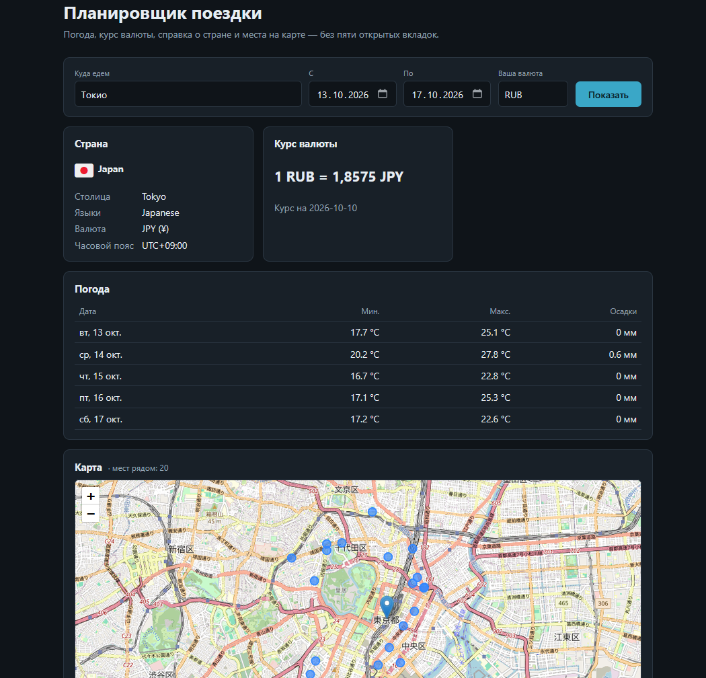
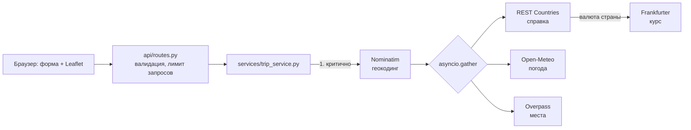

# Trip Planner

Веб-сервис, который по месту назначения и датам поездки собирает в один ответ **погоду по дням, курс валюты, справку о стране и интересные места на карте**. Если один из внешних источников недоступен, остальные блоки всё равно приходят, а сбойный помечается ошибкой.



Учебный проект для портфолио: асинхронный Python-бэкенд, работа с пятью внешними API, устойчивость к сбоям, кэш, тесты без обращения к реальным сервисам, запуск одной командой.

## Быстрый старт

### Docker

```bash
cp .env.example .env        # впишите TRIP_RESTCOUNTRIES_API_KEY, см. ниже
docker compose up --build
```

Откройте <http://localhost:8000> (интерфейс) или <http://localhost:8000/docs> (Swagger).

### Локально

```bash
python3.12 -m venv .venv && source .venv/bin/activate
pip install -e ".[dev]"
cp .env.example .env
uvicorn trip_planner.main:app --reload
```

### Ключ REST Countries

Справка о стране берётся из REST Countries v5, который требует API-ключ. Бесплатный план даёт 1000 запросов в месяц, этого хватает: справка кэшируется на сутки по коду страны. Получите ключ на <https://restcountries.com> и положите в `.env` как `TRIP_RESTCOUNTRIES_API_KEY`.

Без ключа сервис работает, но блок `country` вернёт `api_key_missing`, а зависящий от него блок `currency` — `dependency_failed` (валюта страны назначения берётся из справки). Погода и карта при этом не страдают.

## API

`GET /api/v1/trip?destination=Лиссабон&start=2026-10-20&end=2026-10-24&home_currency=USD`

```json
{
  "destination": {"name": "Lisboa", "lat": 38.71, "lon": -9.14, "country_code": "PT"},
  "country":  {"status": "ok", "data": {"name": "Portugal", "capital": "Lisbon", "currency": "EUR", "...": "..."}},
  "weather":  {"status": "ok", "data": [{"date": "2026-10-20", "t_min": 12.1, "t_max": 18.4, "precip_mm": 0.4}]},
  "currency": {"status": "error", "error": "upstream_timeout"},
  "places":   {"status": "ok", "data": [{"name": "Castelo de São Jorge", "lat": 38.71, "lon": -9.13, "category": "castle"}]}
}
```

Каждый блок — это `status: ok` с `data` либо `status: error` с кодом `error`. Для погоды при неполном покрытии дат добавляется `warning`.

| Код | Когда |
| --- | --- |
| 200 | Успех, в том числе частичный (ошибки внутри блоков) |
| 404 | Назначение не найдено |
| 422 | Неверные параметры: формат дат, конец раньше начала, поездка длиннее 31 дня, неизвестный код валюты |
| 429 | Превышен лимит запросов к API (по умолчанию 30 в минуту с одного IP) |
| 502 | Недоступен геокодинг: без координат ответ невозможен |

Коды ошибок в блоках: `upstream_timeout`, `upstream_unavailable`, `upstream_bad_response`, `currency_unsupported`, `api_key_missing`, `dependency_failed`, `country_unknown`, `internal_error`.

Служебные: `GET /api/v1/health`, `GET /docs`. Каждый ответ содержит заголовок `X-Request-ID`, тот же идентификатор попадает в JSON-логи.

> **Про даты.** Open-Meteo даёт прогноз примерно на 16 дней вперёд. Для более дальних дат блок `weather` вернёт пустой список с `warning`, это штатное поведение, а не ошибка. Чтобы увидеть погоду, берите даты в ближайшие две недели.

## Архитектура



**Поток запроса**

1. Роутер проверяет параметры (даты, код валюты) и передаёт запрос в `TripService`.
2. Геокодинг определяет координаты и страну. Это единственный критичный шаг: при сбое ответ 404 или 502.
3. Справка о стране, погода и места запрашиваются параллельно. Курс валюты стартует сразу же, но ждёт справку, потому что валюта страны берётся из неё.
4. Сервис собирает единый ответ. Сбой любого блока превращается в `status: error` внутри этого блока.

Слои: `clients/` знают только про свой внешний API и возвращают доменные модели, `services/` склеивает клиентов и кэш, `api/` занимается HTTP. Внутри клиентов формат внешнего ответа описан pydantic-моделями: неожиданный формат превращается в контролируемую ошибку `upstream_bad_response`, а не в 500.

## Внешние API

Ограничения сверены с документацией 10.10.2026. Все URL и ключи вынесены в настройки (`TRIP_*`).

| Источник | Что берёт | Ключ | Что важно |
| --- | --- | --- | --- |
| [Nominatim](https://operations.osmfoundation.org/policies/nominatim/) | Координаты и страна | нет | Не чаще 1 запроса в секунду, обязателен свой User-Agent, результаты кэшировать, автодополнение запрещено |
| [Open-Meteo](https://open-meteo.com/en/docs) | Дневной прогноз | нет | Горизонт до 16 дней |
| [Frankfurter v2](https://frankfurter.dev/) | Курс пары валют | нет | Эндпоинт `/v2/rate/{base}/{quote}`, лимиты есть, но без дневных и месячных квот |
| [REST Countries v5](https://restcountries.com/) | Справка о стране | **да** | Версия 3.1 закрыта; бесплатно 1000 запросов в месяц |
| [Overpass API](https://wiki.openstreetmap.org/wiki/Overpass_API) | Достопримечательности | нет | Публичный сервер перегружен: малый радиус, короткий таймаут, при 429 пауза |

## Принятые решения

**Почему async.** Один запрос пользователя превращается в четыре-пять походов во внешние сервисы. Они независимы, поэтому идут параллельно через `asyncio.gather`, и время ответа равно самому медленному источнику (плюс цепочка «страна → курс»), а не сумме всех. Это видно в тесте `test_blocks_are_requested_in_parallel`.

**Почему частичный ответ.** Бесплатные API падают и меняют формат. Для пользователя погода без курса полезнее, чем ошибка на весь экран, поэтому сбой одного блока даёт 200 и ошибку внутри блока. Исключение сделано для геокодинга: без координат остальным блокам нечего считать, и это честный 404 или 502.

**Таймауты и повторы.** На каждый вызов 5 секунд и не более 2 повторов с растущей паузой (0.3 с, 0.6 с). Повторяются только временные сбои: таймаут, сетевая ошибка, 429 и 5xx. Ошибки 4xx не повторяются. Для Overpass таймаут 10 секунд и один повтор: сервер медленный, но долго ждать его не стоит.

**Почему такой кэш.** Срок жизни зависит от того, как часто меняются данные: геокодинг и справка о стране — сутки (почти не меняются, а Nominatim и бесплатный лимит REST Countries надо беречь), курс — час, погода — 30 минут, места — 6 часов. Кэш в памяти процесса (`cachetools`), с защитой от «толпы»: если пять запросов одновременно просят один ключ, во внешний сервис уходит один. Ошибки не кэшируются. При нескольких воркерах или инстансах кэш и лимит запросов стоит вынести в Redis; для одного процесса это лишняя инфраструктура.

**Окно прогноза с запасом.** Дату «сегодня» в точке назначения мы не знаем, поэтому окно прогноза считается по UTC с запасом в день. Так запрос не получит 400 от Open-Meteo в часовом поясе, который отстаёт от UTC.

**Пауза Nominatim.** Минимальный интервал между запросами к Nominatim обеспечивает блокировка внутри клиента: параллельные вызовы встают в очередь.

**Ограничение частоты.** Скользящее окно по IP в памяти. За обратным прокси нужен `--proxy-headers`, иначе все клиенты будут выглядеть как один адрес (в Dockerfile это уже включено).

## Чего нет и почему

- **Автодополнение (FR-12).** Политика Nominatim прямо запрещает строить автодополнение на его API. Для него нужен другой геокодер или собственный инстанс, поэтому в MVP его нет.
- **Курс не для всех пар.** Если Frankfurter не знает валюту, блок `currency` вернёт `currency_unsupported`, остальные блоки не пострадают.
- **Нет базы данных, регистрации и бронирования** — как и сказано в ТЗ.

## Тесты и качество

```bash
pytest --cov            # 60 тестов на моках HTTP (respx), порог покрытия 80%
ruff check . && ruff format --check .
mypy
pytest -m live          # необязательные проверки с реальными API, вручную
```

Реальные сервисы в обычных тестах не вызываются: клиенты проверяются на сохранённых примерах ответов из `tests/fixtures/`, сервис — на сценариях «всё работает», «сбой одного источника», «сбой справки», «нет ключа», «нет геокодинга». Роуты проверяются через `TestClient`. CI (GitHub Actions) на каждый push и pull request запускает ruff, mypy, pytest с покрытием и сборку Docker-образа.

## Развёртывание

Образ собирается из `Dockerfile`, конфигурация целиком через переменные окружения. На Render, Fly.io или VPS достаточно запустить контейнер, задать `TRIP_RESTCOUNTRIES_API_KEY` и `TRIP_USER_AGENT` (с вашим контактом: Nominatim и Overpass требуют идентификацию) и пробросить порт 8000. Проверка живости: `GET /api/v1/health`. После публикации вставьте ссылку в начало этого файла.

## Структура

```
src/trip_planner/
  main.py            приложение, сборка зависимостей, обработчики ошибок
  config.py          настройки (TRIP_*)
  cache.py           асинхронный TTL-кэш
  errors.py          контролируемые ошибки и их коды
  observability.py   JSON-логи, X-Request-ID
  api/               routes.py, schemas.py, ratelimit.py
  clients/           base.py + geocoding, weather, currency, country, places
  services/          trip_service.py
frontend/            шаблон Jinja2, стили, app.js, Leaflet (vendored)
tests/               test_clients/, test_trip_service.py, test_routes.py, test_support.py
```

## Лицензия

MIT. Leaflet распространяется по лицензии BSD-2 (`frontend/static/vendor/leaflet/LICENSE`). Данные карты: © участники [OpenStreetMap](https://www.openstreetmap.org/copyright), лицензия ODbL.
Реализовано при поддержке Claude, Antropic.